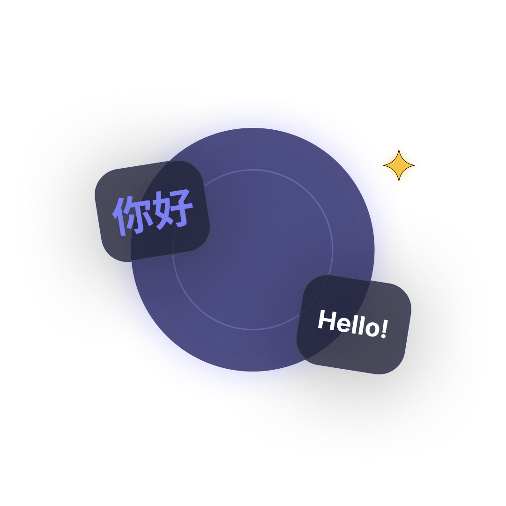
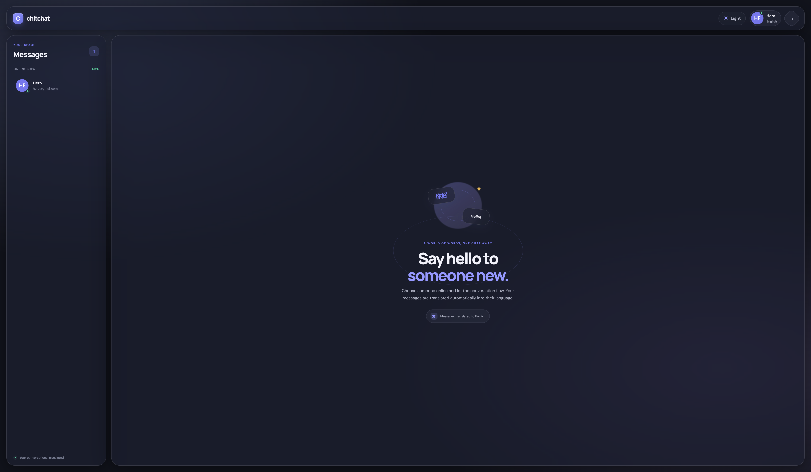
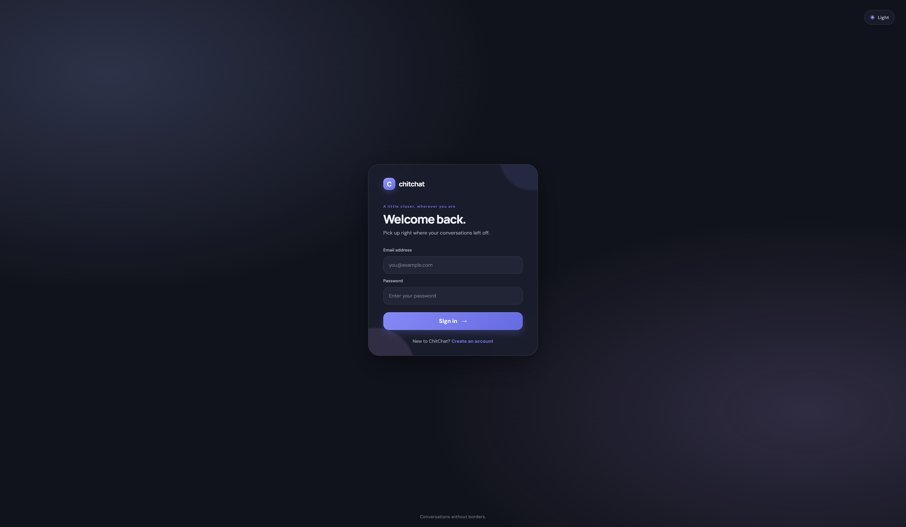
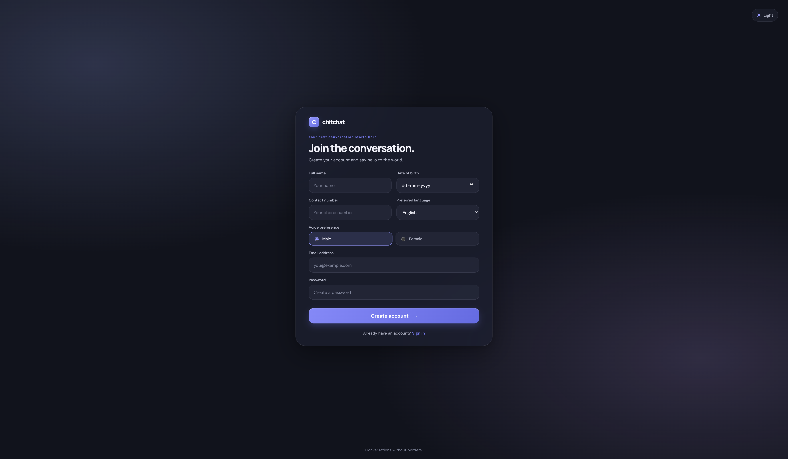

<div align="center">
  
  <h1>ChitChat</h1>
  <p><strong>Conversations without borders.</strong></p>
  <p>A real-time chat app with automatic message translation.</p>
</div>

<p align="center">
  
</p>

## Overview

ChitChat is a full-stack messaging app built with React, Firebase, Flask, and
Socket.IO. Users can create accounts, see who's online, and exchange private
messages translated into the recipient's language.

### Features

- Email and password authentication with Firebase Authentication
- User profiles stored in Cloud Firestore
- Live online-user updates and private real-time chat
- Automatic translation using Helsinki-NLP MarianMT models
- Dark and light themes
- Responsive chat interface

### Screenshots

<p align="center">
  
  
</p>

## Translation support

The backend currently has translation models for these language pairs:

| Source | Target |
| --- | --- |
| English | Hindi |
| Hindi | English |
| English | Spanish |
| Spanish | English |

` Note: Other language choices may appear in the sign-up form, but the backend does not
currently provide translation models for them. `

## Requirements

- Node.js and npm
- Python 3.10 or later
- A Firebase project with Authentication and Cloud Firestore enabled
- Internet access the first time the backend starts, to download the translation
  models

## Getting started

### 1. Clone the repository

```sh
git clone https://github.com/SauRavRwT/ChitChat.git
cd ChitChat
```

### 2. Configure Firebase and the backend URL

In the [Firebase Console](https://console.firebase.google.com/):

1. Create or select a Firebase project and register a **Web app**.
2. Enable **Email/Password** under Authentication sign-in providers.
3. Create a **Cloud Firestore** database.
4. Copy the web app configuration values.

Copy `env.example` to `.env` in the project root, then replace the placeholders
with your Firebase web app values and the address of the Python server:

```env
VITE_BACKEND_URL=http://127.0.0.1:8080
VITE_FIREBASE_API_KEY=your_firebase_api_key
VITE_FIREBASE_AUTH_DOMAIN=your_project.firebaseapp.com
VITE_FIREBASE_DATABASE_URL=https://your_project-default-rtdb.firebaseio.com
VITE_FIREBASE_PROJECT_ID=your_project
VITE_FIREBASE_STORAGE_BUCKET=your_project.firebasestorage.app
VITE_FIREBASE_MESSAGING_SENDER_ID=your_messaging_sender_id
VITE_FIREBASE_APP_ID=your_app_id
```

`VITE_BACKEND_URL` should use `127.0.0.1` when the browser and backend run on
the same computer. To connect from another device on your network, use the
backend computer's LAN IP address instead, for example
`http://192.168.1.20:8080`. Ensure the device can reach that computer and that
the firewall allows inbound connections on port `8080`.

The `.env` file is ignored by Git. Vite embeds `VITE_*` values in the client
bundle, so Firebase web configuration is not a place for private credentials.
Secure Firebase data with appropriate Authentication and Firestore security
rules, and restrict the Firebase API key in the Google Cloud Console as
appropriate.

### 3. Install frontend dependencies

```sh
npm install
```

### 4. Set up the Python backend

Create a virtual environment from the repository root:

**Windows (PowerShell):**

```powershell
py -m venv venv
.\venv\Scripts\Activate.ps1
python -m pip install --upgrade pip
pip install -r requirements.txt
```

**macOS / Linux:**

```sh
python3 -m venv venv
source venv/bin/activate
python -m pip install --upgrade pip
pip install -r requirements.txt
```

The backend loads four translation models at startup. The first launch can take
longer while the model files download and initialize; later launches use the
local model cache.

### 5. Start the app

Run the backend and frontend in separate terminals, from the repository root.
Activate the virtual environment in the backend terminal first.

**Terminal 1 — Python backend:**

```sh
python App.py
```

The backend listens on port `8080`.

**Terminal 2 — Vite frontend:**

```sh
npm start
```

Open the local URL printed by Vite, usually
[http://localhost:5173](http://localhost:5173), and create an account.

## Development commands

| Command | Description |
| --- | --- |
| `npm start` | Start the Vite development server |
| `npm test` | Run the Vitest test suite |
| `npm run build` | Create a production frontend build in `dist/` |

## Troubleshooting

### The browser reports a connection timeout

- Confirm `python App.py` is still running and has finished loading the models.
- Check that `VITE_BACKEND_URL` in `.env` points to the backend's current
  address and port `8080`.
- Restart the Vite server after editing `.env`; Vite reads environment values
  when it starts.
- For another device on the same network, use the backend computer's LAN IP
  address and allow inbound port `8080` through its firewall.

### Firebase sign-in or database requests fail

- Verify Authentication's Email/Password provider is enabled.
- Verify Cloud Firestore is created and its rules allow the intended
  authenticated operations.
- Check that every `VITE_FIREBASE_*` value matches the Firebase web app config.
- Restart Vite after changing `.env`.

### The first backend launch is slow

The MarianMT model files must be downloaded and loaded before the backend is
ready to translate. Check the backend terminal for download or model-loading
errors.

## License

ChitChat is distributed under the MIT License. See [LICENSE](./LICENSE).